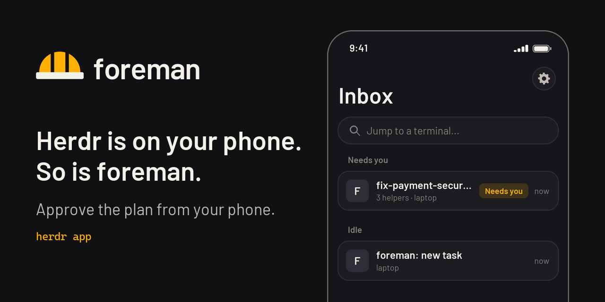

<p align="center"><picture><source media="(prefers-color-scheme: dark)" srcset="https://raw.githubusercontent.com/Kvmyk/herdr-foreman/assets/banner.png"><source media="(prefers-color-scheme: light)" srcset="https://raw.githubusercontent.com/Kvmyk/herdr-foreman/assets/banner-light.png"></picture></p>

# herdr-foreman

[](https://github.com/Kvmyk/herdr-foreman/releases)
[](LICENSE)
[](https://github.com/Kvmyk/herdr-foreman/actions/workflows/ci.yml)

[herdr](https://herdr.dev) is a terminal multiplexer for AI coding agents, with about 38k GitHub stars and a place in the ThoughtWorks Technology Radar (Assess, November 2026). foreman is a plugin for it that gives one task to several coding agents at once.

You have one task and more than one agent: Claude Code, Codex, opencode, agy. Doing it by hand means splitting the work yourself, keeping the agents out of each other's files and checking what each one did. foreman does that for you. A lead agent reads the repository, splits the task, picks an agent and model for each part, and runs every worker in its own git worktree and herdr pane.

**Nothing changes until you approve the plan.** Workers first only read the code and propose changes. The leader puts the proposals in one numbered list and you answer, for example "1 and 3 yes, 2 no". Only then do the workers write code, each in its own worktree. The leader collects and tests the result and asks again before anything lands on your branch. foreman never pushes and never opens a pull request.

```
foreman "check the payment module for security holes and fix what needs fixing"
```

<p align="center"></p>

## Install

```
herdr plugin install Kvmyk/herdr-foreman
```

You need herdr 0.9.5 or newer, **Node.js 20 or newer** ([nodejs.org](https://nodejs.org)), **git** ([git-scm.com](https://git-scm.com)) and **at least one coding agent, signed in**, for example [Claude Code](https://claude.com/claude-code), [Codex](https://developers.openai.com/codex), opencode or agy. The command sets everything up, the Herdr desktop app too if you have it. Only use the desktop app? See [Other ways to install](#other-ways-to-install).

- **Start a task:** open a terminal in your project folder (a git repository with at least one commit). In herdr press `Ctrl+B`, then `F`. In the desktop app press `Ctrl+Shift+Y`, type the task and press `Ctrl+Enter`. The leader opens in a new tab and tells you what it plans before anything changes.
- **From your phone:** the Herdr phone app works with the same install on the machine it connects to. See [From your phone](#from-your-phone).
- **Update:** `herdr plugin update` (or run the install script again).
- **Something does not work:** type `foreman setup`. It checks everything, fixes what it can and says what is left. See [Troubleshooting](docs/troubleshooting.md).

## Start a task (terminal)

1. Open a terminal in your project folder and type `herdr`.
2. Press `Ctrl+B`, let go, then press `F`.
3. Type what you want done, in plain words. You can paste several lines; finish with an empty line. An empty first line cancels.

The lead agent opens in a new tab and tells you what it plans to do before anything changes. In the desktop app, use its prompt instead (see [Herdr app](#herdr-app-desktop)).

### Describing the task

- **Both prompts:** write it in your own words. Point at files with `@` and the file name (`@src/login.js`); links to issues or docs work too. foreman checks that the files exist and warns you when one has changes you have not committed.
- **Command line:** a longer task can be written in a file (`foreman -f task.md`) or piped in (`cat task.md | foreman`).
- **herdr prompt (terminal):** you can paste several lines and finish with an empty line (or Ctrl+D), or type `e` to write the task in an editor (`$VISUAL` or `$EDITOR`; Notepad on Windows).
- **Desktop prompt:** `Enter` is a new line and `Ctrl+Enter` starts, so a long task can be written in the box itself; `@` offers file names.

## Other ways to install

**Herdr desktop app only.** Open the app once first, then in a terminal:

```
# Windows (PowerShell)
irm https://raw.githubusercontent.com/Kvmyk/herdr-foreman/main/install.ps1 | iex

# macOS and Linux
curl -fsSL https://raw.githubusercontent.com/Kvmyk/herdr-foreman/main/install.sh | sh
```

The script checks Node.js and git, runs `npm install -g github:Kvmyk/herdr-foreman` and then `foreman setup`, and prints what, if anything, is left to do (for example an agent to sign in). Read [install.ps1](install.ps1) or [install.sh](install.sh) first if you like, or run those two commands by hand. To update, run it again.

**As a command, or set up by hand:** see [Advanced install](docs/reference.md#advanced-install-as-a-command-or-set-up-by-hand). On Windows, read [Windows and PowerShell](docs/windows.md).

## Herdr app (desktop)

If the Herdr desktop app is installed (its folder is `~/.config/herdr-app`, on Windows `%USERPROFILE%\.config\herdr-app`, or `$HERDR_APP_HOME`), `foreman setup` also adds foreman to it. You do not need the terminal version of herdr for this.

In the app, open a terminal in your project folder and press **Ctrl+Shift+Y**. A prompt opens:

<!-- Screenshot of the desktop prompt goes here. Put desktop-prompt.png on the `assets` branch, then replace this comment with:
<p align="center"></p>
-->

- **Desktop prompt, keys:** `Enter` adds a line, `Ctrl+Enter` (`Cmd+Enter` on a Mac) or the Start button starts, `Esc` cancels. What you typed is kept as a draft when you cancel and comes back the next time.
- **Desktop prompt, `@`:** type `@` and part of a file name to get a list of files of your project; click one to insert it.
- **While workers run:** a worker that is stuck on a question or has stopped puts its name in its tab's title (`⚠ w2 needs you`) and the app brings that tab forward.

More about the prompt, and what setup changes in the app folder: [Reference](docs/reference.md#herdr-app-prompt-details-and-what-setup-changes).

## From your phone

<p align="center"></p>

The Herdr phone app (iPhone, iPad, Android, [herdr.dev/mobile](https://herdr.dev/mobile/)) is a remote client. It connects over SSH to herdr-core on your machine, lists your agents in an Inbox (needs you, done, working, idle) and gives you a terminal with a key bar and a box for composing text.

**What you need**

- the Herdr phone app, connected to your machine
- herdr-core or the Herdr desktop app on that machine
- foreman installed on that machine (see [Install](#install))

Runs use the app backend. A run started in the Herdr terminal app (TUI) does not show on the phone.

**Start a task**

1. With the launcher. The first time you run `foreman setup` in a terminal, it asks whether you want to start foreman from the Herdr phone app; answer `y`. You can also type `foreman launcher on` at any time, or turn on **Phone launcher** in the desktop prompt. A terminal titled `foreman: new task` then sits in your Inbox, in the space you used last. Open it, paste or dictate the task and send it. It asks for the project, the leader, auto and uncommitted changes; answer each by sending a number. The project list includes the repositories of the folders of your Herdr app spaces, even ones with no run yet. It starts the leader, then waits for the next task. `foreman launcher off` turns it off and closes the terminal.
2. Without the launcher. Open any terminal on the machine and type `foreman new` (or just `foreman`). It asks for the task the same way.

**Answer questions**

Answer everything in the terminal of the leader, with short replies such as `1` or `yes`. The leader names the worker, asks one question at a time and passes your answer to the worker itself. You only go to another terminal to sign in to an agent.

**What the phone does not do**

- There is no shortcut and no prompt window; use the launcher or `foreman new`.
- Banners show only while the app is open. To get a message when a worker needs you, set `notifyCommand` in `config.json` (see [Files](docs/reference.md#files)).
- When you type into a terminal from the phone, it gets the width of the phone until you click it on the desktop. Workers are then shown one per tab (`"layout": "tabs"`), and output is shorter under 60 columns.

## How a task runs

1. `foreman "<task>"` in a git repository. Outside herdr it starts the herdr server if needed, opens a workspace and attaches; inside herdr it opens a new tab.
2. The leader (default: `claude`) runs `foreman brief --json`: installed agents, whether they are signed in, their models, what is known about each harness and model family, and your own past results per task category.
3. It shows the plan, then opens workers with `foreman spawn`, each in its own git worktree and pane. Workers are stacked one under another to the right of the leader (up to 4; more go to a tab of their own); `"layout": "grid"` in `config.json` puts them side by side instead.
4. Workers investigate without changing anything and write proposals. The leader merges them into one numbered list; you answer, for example, "1 and 3 yes, 2 no".
5. Approved items are implemented and committed in the workers' worktrees. `foreman merge` collects them on the run branch `<type>/<name>` (for example `feat/auto-accept-workers`; workers use `wip/<name>/<worker>`) in a separate worktree; the leader builds, tests and reviews.
6. You choose: merge into your current branch (`foreman land`), leave the branch for later, or send comments back.
7. `foreman cleanup` closes worker panes and removes worktrees; `foreman journal add` records how each agent did. The leader then asks whether to close its own tab.

Workers write their reports to `.foreman/` inside their own worktree; foreman adds `.foreman/` to the repository's `.git/info/exclude`, so reports never show up in `git status` or a commit.

If a worker asks for permission, the leader asks you once whether you answer such questions yourself or let it answer on your behalf. It never approves a push or a pull request. In auto mode claude workers get `--permission-mode auto` (with `git push` and `gh` denied), opencode `--auto`, and agy `--dangerously-skip-permissions`, because agy's own `--mode auto` still asks before every shell command; the workers run in foreman's own worktrees, which have the push guard.

## Choosing agents

Choosing is based on three layers:

1. **What works right now:** every run probes the installed agents, for example `claude auth status`, `agy models`, `opencode models`, `pi --list-models`. An agent that is not signed in is left out, with the reason.
2. **General knowledge:** `knowledge/agents.json` holds dated facts (benchmark scores with rank, harness and date; the newest release of each program; the newest model of each family), each tied to a renewable public source. Model facts (context, price, release date) come from [models.dev](https://models.dev), fetched at most once a day.
3. **Your results:** the journal in `~/.herdr-foreman/journal.jsonl`. Once a category has 5 or more results, they outweigh the general knowledge.

How that knowledge stays up to date: [Reference](docs/reference.md#keeping-the-knowledge-up-to-date).

## More documentation

- [Troubleshooting](docs/troubleshooting.md): what to do when something does not work
- [FAQ](docs/faq.md): cost, what foreman changes, what it never does, how to remove it
- [Windows and PowerShell](docs/windows.md): PATH, script policy, quoting tasks
- [Reference](docs/reference.md): every subcommand, `config.json` and the other files, token use, the agent knowledge

## Development

```
npm test
```

Tests use only Node's built-in test runner; git tests create throwaway repositories in the system temp directory.

To try the plugin from a working copy, run `herdr plugin link .` in it (and `herdr plugin unlink herdr-foreman` to undo).

Changes are listed in [CHANGELOG.md](CHANGELOG.md).

## Media

The logo, the banners and the demo GIF are original and covered by the same license. The images in this README live on the [`assets`](https://github.com/Kvmyk/herdr-foreman/tree/assets) branch. The demo GIF follows foreman's real flow and command names, but its repository, findings and commit ids are made up. A recording of a real run is planned.

## License

MIT
