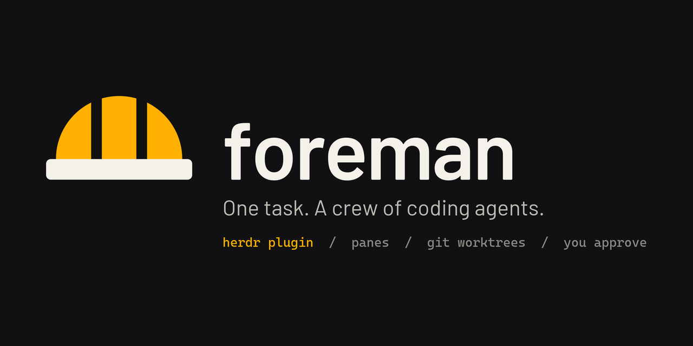
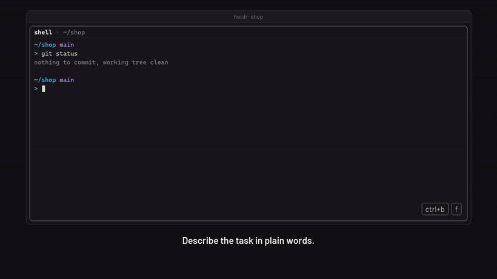

<p align="center"><picture><source media="(prefers-color-scheme: dark)" srcset="media/banner.png"><source media="(prefers-color-scheme: light)" srcset="media/banner-light.png"></picture></p>

<p align="center"><br>
<a href="media/demo.mp4">Watch with sound (32 s, MP4)</a></p>

# herdr-foreman

Describe a task in plain words. A lead agent reads the repository, checks which coding agents you have installed and signed in, splits the work, picks the best agent and model for each part, and runs them side by side in [herdr](https://herdr.dev) panes. Workers first only investigate and propose changes; you approve a single numbered list; then they implement in separate git worktrees, and the leader collects, tests and asks before anything lands on your branch.

```
foreman "check the payment module for security holes and fix what needs fixing"
```

Nothing is pushed and no pull request is created.

## Requirements

- Node.js 20 or newer
- herdr 0.9.5 or newer
- git
- at least one coding agent herdr can start (claude, codex, opencode, agy, pi, gemini, ...), signed in

## Install

### As a herdr plugin

```
herdr plugin install Kvmyk/herdr-foreman
```

herdr shows the manifest and the commands it will run before you confirm. Then bind a key in herdr's `config.toml` (`herdr --help` prints its path):

```toml
[[keys.command]]
key = "prefix+f"
type = "plugin_action"
command = "herdr-foreman.start"
description = "foreman: new task"
```

Run `herdr server reload-config`. In any pane inside a git repository, press `prefix+f` (default `ctrl+b`, then `f`), type the task and press Enter; an empty line cancels. The leader opens in a new tab of the same workspace. Without a key binding: `herdr plugin action invoke herdr-foreman.start`.

### As a command

```
npm install -g github:Kvmyk/herdr-foreman
```

or clone the repository and run `npm link` in it. Then run `foreman "<task>"` in any git repository: outside herdr it starts the herdr server if needed and attaches; inside herdr it opens a new tab.

The plugin and the command run the same code. If `foreman` is not on your PATH, the leader is told to run its subcommands as `node /path/to/herdr-foreman/bin/foreman.js`.

## How a task runs

1. `foreman "<task>"` in a git repository. Outside herdr it starts the herdr server if needed, opens a workspace and attaches; inside herdr it opens a new tab.
2. The leader (default: `claude`) runs `foreman brief --json`: installed agents, whether they are signed in, their models, what is known about each harness and model family, and your own past results per task category.
3. It shows the plan, then opens workers with `foreman spawn`, each in its own git worktree and pane.
4. Workers investigate without changing anything and write proposals. The leader merges them into one numbered list; you answer, for example, "1 and 3 yes, 2 no".
5. Approved items are implemented and committed in the workers' worktrees. `foreman merge` collects them on the run branch `<type>/<name>` (for example `feat/auto-accept-workers`; workers use `wip/<name>/<worker>`) in a separate worktree; the leader builds, tests and reviews.
6. You choose: merge into your current branch (`foreman land`), leave the branch for later, or send comments back.
7. `foreman cleanup` closes worker panes and removes worktrees; `foreman journal add` records how each agent did. The leader then asks whether to close its own tab.

Workers write their reports to `.foreman/` inside their own worktree; foreman adds `.foreman/` to the repository's `.git/info/exclude`, so reports never show up in `git status` or a commit.

If a worker asks for permission, the leader asks you once whether you answer such questions yourself or let it answer on your behalf. It never approves a push or a pull request.

## Subcommands

| Command | What it does |
|---|---|
| `foreman agents [--json]` | Installed agent kinds: signed in?, models, default model |
| `foreman brief [--json]` | Inventory, knowledge, models.dev facts and your stats in one JSON |
| `foreman spawn --task <slug> [--new-tab] [--effort <level>] [--full] [--auto] [--branch <type>/<name>] <name>=<kind>[:<model>]...` | Open workers in worktrees and panes. `--branch` (required on a task's first spawn) names the run, e.g. `feat/auto-accept-workers`; `--auto` starts workers in their auto-approve mode. `--effort low\|medium\|high\|xhigh\|max` (claude, agy); `--full` keeps MCP servers and skills for claude workers |
| `foreman wait --task <slug> [--phase investigate\|implement] [--only a,b] [--timeout ms]` | Block until every worker finished (its report written) or one needs attention; returns within 9 minutes |
| `foreman status --task <slug> [--json]` | Changes, commits and reports per worker |
| `foreman merge --task <slug> [--only a,b] [--json]` | Collect committed work on the run branch |
| `foreman land --task <slug> [--title <summary>]` | Merge the run branch into your current branch as `Merge <type>/<name>: <summary>` (refuses with uncommitted changes) |
| `foreman cleanup --task <slug> [--delete-branch]` | Close worker panes, remove worktrees and worker branches |
| `foreman cleanup [--all]` | List runs left behind (open workers, worktrees); `--all` cleans them. Panes are closed only if they still host that worker or work inside its worktree |
| `foreman close-leader` | Close the calling leader's pane; the leader's last step when you agree |
| `foreman journal add <file.json>` / `foreman journal stats` | Record and view results per category and agent |

A task that starts with a subcommand name still starts a leader (`foreman status page is broken` is a task). `foreman -- <words>` forces it.

## Choosing agents

Choosing is based on three layers:

1. **What works right now:** every run probes the installed agents, for example `claude auth status`, `agy models`, `opencode models`, `pi --list-models`. An agent that is not signed in is left out, with the reason.
2. **General knowledge:** `knowledge/agents.json` holds harness strengths and model family tendencies, with dates and sources. Model facts (context, price, release date) come from [models.dev](https://models.dev), fetched at most once a day.
3. **Your results:** the journal in `~/.herdr-foreman/journal.jsonl`. Once a category has 5 or more results, they outweigh the general knowledge.

## Token use

Every turn an agent takes re-sends its whole conversation, so foreman cuts turns and per-turn context rather than thinking (details and measurements in `docs/research/2026-11-07-tokeny.md`):

- **`foreman wait`:** the leader blocks once instead of polling workers; it gets a worker's screen only when that worker asks something.
- **Lean starts:** claude leaders and workers start without MCP servers, skills and unused tools. That measured about 23k instead of 44k tokens of context per turn. Use `--full` for a worker that needs them, or set `"lean": false`.
- **Effort per worker:** `--effort low` for mechanical parts, higher only where reasoning pays.
- **Compact data:** `foreman brief` carries only what planning needs (about 9k characters instead of 33k), and `--json` output has no whitespace.
- **Leader instructions:** batched commands, targeted briefs (files and test command) and short reports.

## Files

Everything lives in `~/.herdr-foreman/` (set `FOREMAN_HOME` to move it):

| Path | Contents |
|---|---|
| `config.json` | Optional: `leader`, `maxWorkers` (default 6), `startTimeoutMs`, `waitTimeoutMs` (default 540000; use 240000 with an API key, whose cache lasts 5 minutes), `lean` (default true), `leaderArgs` (extra leader flags, e.g. `["--effort", "high"]`), `knowledgeUrl`, `excludeKinds` |
| `knowledge.override.json` | Optional: your corrections to the knowledge file, deep-merged |
| `journal.jsonl` | Your results |
| `worktrees/` | Worker worktrees, outside your repository |
| `runs/` | One record per task, plus worker reports |

## Development

```
npm test
```

Tests use only Node's built-in test runner; git tests create throwaway repositories in the system temp directory.

To try the plugin from a working copy, run `herdr plugin link .` in it (and `herdr plugin unlink herdr-foreman` to undo).

## Media

The logo (`media/logo.svg`), the banners, the demo videos and their music are original and covered by the same license. `media/src/` holds the scripts that make them: `brand.py` draws the logo and both banners with Pillow, using the Barlow font vendored in `media/src/fonts/` under the SIL Open Font License; `music.py` synthesises an ambient pad and key-click foley with numpy; `demo.py` draws the frames with Pillow and encodes them with ffmpeg, both for `media/demo.mp4` (16:9) and for the 29-second 4:5 LinkedIn cut `media/demo-linkedin.mp4` with its captions as `media/demo-linkedin.srt` and its 1080x1350 cover `media/demo-linkedin-cover.png`; and `gif.py` turns the 16:9 cut into `media/demo.gif` with ffmpeg. The run in the videos follows foreman's real flow and command names; its repository, findings and commit ids are made up.

## License

MIT
