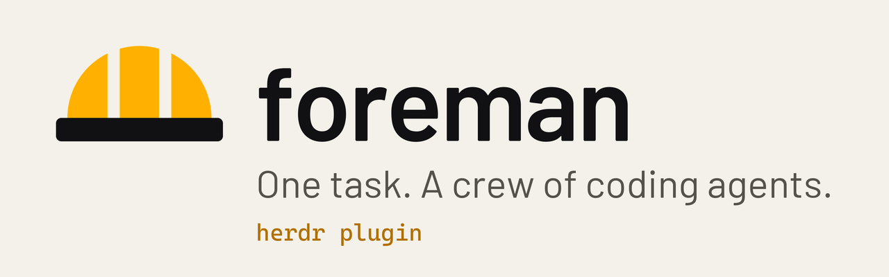

<p align="center"><picture><source media="(prefers-color-scheme: dark)" srcset="https://raw.githubusercontent.com/Kvmyk/herdr-foreman/assets/banner.png"><source media="(prefers-color-scheme: light)" srcset="https://raw.githubusercontent.com/Kvmyk/herdr-foreman/assets/banner-light.png"></picture></p>

<p align="center"></p>

# herdr-foreman

Describe a task in plain words. A lead agent reads the repository, checks which coding agents you have installed and signed in, splits the work, picks the best agent and model for each part, and runs them side by side in [herdr](https://herdr.dev) panes. Workers first only investigate and propose changes; you approve a single numbered list; then they implement in separate git worktrees, and the leader collects, tests and asks before anything lands on your branch.

```
foreman "check the payment module for security holes and fix what needs fixing"
```

Nothing is pushed and no pull request is created.

## Before you start

You need four things on your computer:

1. **herdr 0.9.5 or newer**, the terminal app foreman runs in. Install it from [herdr.dev](https://herdr.dev).
2. **Node.js 20 or newer**, from [nodejs.org](https://nodejs.org).
3. **git**, from [git-scm.com](https://git-scm.com). Your project folder must use git.
4. **At least one coding agent, signed in**: for example [Claude Code](https://claude.com/claude-code) or [Codex](https://developers.openai.com/codex). Others herdr can start (opencode, agy, pi, gemini, ...) work too.

## Install

Open a terminal and type:

```
herdr plugin install Kvmyk/herdr-foreman
```

herdr shows what the plugin will run and asks you to confirm; answer yes. That is all: foreman adds its keyboard shortcut to herdr by itself.

## Start a task

1. Open a terminal in your project folder and type `herdr`.
2. Press `Ctrl+B`, let go, then press `F`.
3. Type what you want done, in plain words. You can paste several lines; finish with an empty line. An empty first line cancels.

The lead agent opens in a new tab and tells you what it plans to do before anything changes.

### Describing the task

- Write it in your own words. Point at files with `@` and the file name (`@src/login.js`); links to issues or docs work too. foreman checks that the files exist and warns you when one has changes you have not committed.
- A longer task can be written in a file (`foreman -f task.md`) or piped in (`cat task.md | foreman`).
- In the herdr prompt you can paste several lines and finish with an empty line (or Ctrl+D), or type `e` to write the task in an editor (`$VISUAL` or `$EDITOR`; Notepad on Windows).

## If something does not work

Type this in a terminal; it checks herdr, git and your coding agents, fixes what it can and tells you in plain words what is left to do:

```
herdr plugin pane open --plugin herdr-foreman --entrypoint setup
```

(If you installed the `foreman` command, below, `foreman setup` or just `foreman` does the same.)

- **The shortcut does nothing:** if `Ctrl+B, then F` was already taken, foreman picked `Ctrl+B, then Shift+F` (or `Alt+F`); the check above shows which one.
- **An agent is not signed in:** the check shows the exact line to type to sign in.
- **To undo the shortcut:** foreman saved your previous herdr settings next to them as `config.toml.foreman-backup`.

## Advanced: install as a command, or set up by hand

As a command, for use in any terminal:

```
npm install -g github:Kvmyk/herdr-foreman
```

Then run `foreman "<task>"` in any git repository: outside herdr it starts the herdr server if needed and attaches; inside herdr it opens a new tab. Run `foreman setup` (or just `foreman`) once after the npm install to add foreman to herdr and bind the shortcut. You can also clone the repository and run `npm link` in it; a clone is set up only when you run `foreman setup`. The plugin and the command run the same code. If `foreman` is not on your PATH, the leader is told to run its subcommands as `node /path/to/herdr-foreman/bin/foreman.js`.

What setup changes: it appends this block to herdr's `config.toml` (`herdr --help` prints its path; on Windows it is usually `%APPDATA%\herdr\config.toml`), after checking the result with `herdr config check`, and runs `herdr server reload-config`:

```toml
[[keys.command]]
key = "prefix+f"
type = "plugin_action"
command = "herdr-foreman.start"
description = "foreman: new task"
```

It never replaces a key you bound yourself to `herdr-foreman.start`. herdr runs the same quiet setup at every server start, so the shortcut comes back after `herdr config reset-keys`; to stop all automatic setup, put `"autoSetup": false` in `~/.herdr-foreman/config.json` or set `FOREMAN_NO_SETUP=1`. If no lead agent is configured and Claude Code is not ready, setup picks one you have and saves it there as `leader`. Without any key binding: `herdr plugin action invoke herdr-foreman.start`.

## Windows and PowerShell

foreman works in PowerShell like any other command; a few things are different from the examples above.

- **Finding the command:** `npm install -g github:Kvmyk/herdr-foreman` puts `foreman` in `%APPDATA%\npm`. Open a new PowerShell window after installing Node.js and foreman, so it sees the new PATH. `Get-Command foreman` should find it.
- **"running scripts is disabled on this system":** PowerShell blocks npm's `foreman.ps1`. Run `Set-ExecutionPolicy -Scope CurrentUser RemoteSigned` once, or type `foreman.cmd` instead of `foreman`.
- **Quote the task with single quotes:** `foreman 'fix the $price rounding in @src/cart.js'`. Inside double quotes PowerShell replaces `$price` with a variable and treats a backtick as an escape.
- **Long tasks:** use `foreman -f task.md`. In Windows PowerShell 5.1, `Get-Content task.md | foreman` turns letters such as ą, é or ß into `?`; if you want to pipe, first run `$OutputEncoding = [Text.UTF8Encoding]::new()`. PowerShell 7.4 and newer pipe correctly.
- **Tasks with `&`, `|`, `<`, `>`, `^` or `%`:** through `foreman.cmd` they go through cmd.exe, which can cut the task short. Put such a task in a file and use `-f`.
- **An editor for the task:** the herdr prompt opens Notepad. For VS Code, set `$env:EDITOR = 'code --wait'` (without `--wait` the editor returns at once and foreman tells you so).
- **From a clone, without npm:** `node C:\path\to\herdr-foreman\bin\foreman.js 'your task'`.
- **Where things are:** herdr's settings in `%APPDATA%\herdr\config.toml`, the Herdr app folder in `%USERPROFILE%\.config\herdr-app`, foreman's own files in `%USERPROFILE%\.herdr-foreman`. To look at herdr's settings: `notepad $env:APPDATA\herdr\config.toml`.

With herdr in the terminal, type `herdr` and press `Ctrl+B`, then `F`, as above; `foreman '<task>'` typed outside herdr starts it for you. In the Herdr desktop app the prompt (`Ctrl+Shift+Y`) starts node directly, so PowerShell quoting does not matter there.

## Herdr app (desktop)

If the Herdr desktop app is installed (its folder is `~/.config/herdr-app`, on Windows `%USERPROFILE%\.config\herdr-app`, or `$HERDR_APP_HOME`), setup also adds foreman to it. You do not need the terminal version of herdr for this: install the command with `npm install -g github:Kvmyk/herdr-foreman`, or type `foreman setup` in a clone.

In the app, open a terminal in your project folder and press **Ctrl+Shift+Y**. A prompt opens; type your task and press Enter (or Start). foreman opens the leader in a new tab of the same space. Esc or an empty task cancels.

What setup changes, checked first and never forced:

- `mods/foreman/` in the app folder: the prompt. Its `main.js` starts with a `foreman-managed` line holding the version and a hash. The mod is checked with `herdr-app check` before it is written. A newer foreman updates it; a file you edited, or a `mods/foreman` that is not foreman's, is left alone and setup says so.
- one line in `keys.json`, `"ctrl-shift-y": "mod.open:foreman"` (the first of `ctrl-shift-y`, `ctrl-alt-shift-f`, `ctrl-shift-f10` that you have not bound). Your old keys are saved as `keys.json.foreman-backup`, and if the app rejects the new file (`keys.error`) your keys are put back. A missing or invalid `keys.json` is never created or replaced; open the app once and type `foreman setup` again.
- the + menu is not changed: the app replaces its own menus at every start. To use another key, change the line in `keys.json`.

Setup reruns quietly whenever herdr starts. `"autoSetup": false` in `~/.herdr-foreman/config.json` (or `FOREMAN_NO_SETUP=1`) stops that; `foreman setup` still works. To remove foreman from the app, delete `mods/foreman` and that line.

The prompt starts foreman as `node <foreman>/bin/foreman.js --backend app -- "<task>"` in a terminal tab of the app, in the folder of the focused terminal.

## How a task runs

1. `foreman "<task>"` in a git repository. Outside herdr it starts the herdr server if needed, opens a workspace and attaches; inside herdr it opens a new tab.
2. The leader (default: `claude`) runs `foreman brief --json`: installed agents, whether they are signed in, their models, what is known about each harness and model family, and your own past results per task category.
3. It shows the plan, then opens workers with `foreman spawn`, each in its own git worktree and pane.
4. Workers investigate without changing anything and write proposals. The leader merges them into one numbered list; you answer, for example, "1 and 3 yes, 2 no".
5. Approved items are implemented and committed in the workers' worktrees. `foreman merge` collects them on the run branch `<type>/<name>` (for example `feat/auto-accept-workers`; workers use `wip/<name>/<worker>`) in a separate worktree; the leader builds, tests and reviews.
6. You choose: merge into your current branch (`foreman land`), leave the branch for later, or send comments back.
7. `foreman cleanup` closes worker panes and removes worktrees; `foreman journal add` records how each agent did. The leader then asks whether to close its own tab.

Workers write their reports to `.foreman/` inside their own worktree; foreman adds `.foreman/` to the repository's `.git/info/exclude`, so reports never show up in `git status` or a commit.

If a worker asks for permission, the leader asks you once whether you answer such questions yourself or let it answer on your behalf. It never approves a push or a pull request.

## Subcommands

| Command | What it does |
|---|---|
| `foreman agents [--json]` | Installed agent kinds: signed in?, models, default model |
| `foreman brief [--json]` | Inventory, knowledge, models.dev facts and your stats in one JSON |
| `foreman spawn --task <slug> [--new-tab] [--effort <level>] [--full] [--auto] [--branch <type>/<name>] [--include-uncommitted] <name>=<kind>[:<model>]...` | Open workers in worktrees and panes. `--branch` (required on a task's first spawn) names the run, e.g. `feat/auto-accept-workers`; `--auto` starts workers in their auto-approve mode; `--include-uncommitted` starts workers from a copy that also holds your uncommitted changes. `--effort low\|medium\|high\|xhigh\|max` (claude, agy); `--full` keeps MCP servers and all tools for claude workers |
| `foreman wait --task <slug> [--phase investigate\|implement] [--only a,b] [--timeout ms]` | Block until every worker finished (its report written) or one needs attention; returns within 9 minutes |
| `foreman status --task <slug> [--json]` | Changes, commits and reports per worker |
| `foreman merge --task <slug> [--only a,b] [--json]` | Collect committed work on the run branch |
| `foreman land --task <slug> [--title <summary>]` | Merge the run branch into your current branch as `Merge <type>/<name>: <summary>` (refuses with uncommitted changes) |
| `foreman cleanup --task <slug> [--delete-branch]` | Close worker panes, remove worktrees and worker branches |
| `foreman cleanup [--all]` | List runs left behind (open workers, worktrees); `--all` cleans them. Panes are closed only if they still host that worker or work inside its worktree |
| `foreman prompt --task <slug> <name> "<text>"` | Send an agent a message |
| `foreman read --task <slug> <name> [--lines n]` | Print what an agent's pane shows (`n` lines of history too) |
| `foreman keys --task <slug> <name> <key>...` | Press keys in an agent's pane: `enter`, `esc`, `up`, `down`, `1`, ... `prompt`, `read` and `keys` also take `--backend app\|herdr` |
| `foreman close-leader` | Close the calling leader's pane; the leader's last step when you agree |
| `foreman journal add <file.json>` / `foreman journal stats` | Record and view results per category and agent |

A task that starts with a subcommand name still starts a leader (`foreman status page is broken` is a task). `foreman -- <words>` forces it.

## Choosing agents

Choosing is based on three layers:

1. **What works right now:** every run probes the installed agents, for example `claude auth status`, `agy models`, `opencode models`, `pi --list-models`. An agent that is not signed in is left out, with the reason.
2. **General knowledge:** `knowledge/agents.json` holds harness strengths and model family tendencies, with dates and sources. Model facts (context, price, release date) come from [models.dev](https://models.dev), fetched at most once a day.
3. **Your results:** the journal in `~/.herdr-foreman/journal.jsonl`. Once a category has 5 or more results, they outweigh the general knowledge.

## Token use

Every turn an agent takes re-sends its whole conversation, so foreman cuts turns and per-turn context rather than thinking (details and measurements in `docs/research/2026-11-07-tokens.md`):

- **`foreman wait`:** the leader blocks once instead of polling workers; it gets a worker's screen only when that worker asks something.
- **Lean starts:** claude leaders and workers start without MCP servers and unused tools; your own skills (`~/.claude/skills` and plugin skills) and built-in slash commands such as `/usage` keep working. That measured about 23k instead of 44k tokens of context per turn. Use `--full` for a worker that needs them, or set `"lean": false`.
- **Effort per worker:** `--effort low` for mechanical parts, higher only where reasoning pays.
- **Compact data:** `foreman brief` carries only what planning needs (about 9k characters instead of 33k), and `--json` output has no whitespace.
- **Leader instructions:** batched commands, targeted briefs (files and test command) and short reports.

## Files

Everything lives in `~/.herdr-foreman/` (set `FOREMAN_HOME` to move it):

| Path | Contents |
|---|---|
| `config.json` | Optional: `leader`, `maxWorkers` (default 6), `startTimeoutMs`, `waitTimeoutMs` (default 540000; use 240000 with an API key, whose cache lasts 5 minutes), `lean` (default true), `leaderArgs` (extra leader flags, e.g. `["--effort", "high"]`), `knowledgeUrl`, `excludeKinds`, `autoSetup` (default true; false stops foreman adding or restoring its herdr and Herdr app shortcuts) |
| `knowledge.override.json` | Optional: your corrections to the knowledge file, deep-merged |
| `journal.jsonl` | Your results |
| `worktrees/` | Worker worktrees, outside your repository |
| `runs/` | One record per task, plus worker reports |

## Development

```
npm test
```

Tests use only Node's built-in test runner; git tests create throwaway repositories in the system temp directory.

To try the plugin from a working copy, run `herdr plugin link .` in it (and `herdr plugin unlink herdr-foreman` to undo).

Changes are listed in [CHANGELOG.md](CHANGELOG.md).

## Media

The logo, the banners, the demo videos and their music are original and covered by the same license. The images in this README live on the [`assets`](https://github.com/Kvmyk/herdr-foreman/tree/assets) branch. The run in the videos follows foreman's real flow and command names; its repository, findings and commit ids are made up.

## License

MIT
